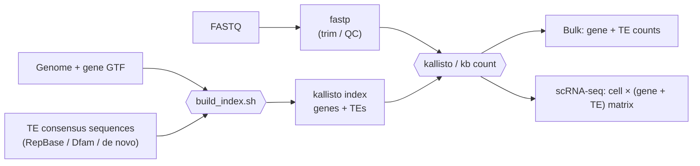

# kallisto-TE

**Quantify transposable element (TE) expression together with canonical
genes from bulk and single-cell RNA-seq, using kallisto | bustools.**

Typical workflows ignore the TEs in downstream analysis either leaving them uncounted or unmapped.

kallisto-TE adds the consensus sequence of every TE subfamily (e.g.
`MMERVK10C`, `IAPEz-int`, `L1HS`, `AluY`) to the transcriptome as if it were an
extra gene. A single pseudoalignment then gives you one count matrix with
**genes and TE subfamilies side by side**, using the same index for bulk
RNA-seq (`kallisto quant` / `kb count`) and droplet single-cell RNA-seq
(`kb count`, 10x Genomics and others).

It works for **mouse and human out of the box** and for **any other species**
(plants, fish, insects, ...) that has a genome, a gene annotation and TE
consensus sequences.



---

## Quick start

```bash
# 1. Get the code and the software
git clone https://github.com/issabrianzhang/kallisto-TE.git
cd kallisto-TE
mamba env create -f envs/kallisto_te.yaml      # or: conda env create -f envs/kallisto_te.yaml
conda activate kallisto_te

# 2. Make sure it works (toy data, < 1 minute)
bash test/run_toy_test.sh
```

### 3. Build a real index

`build_index.sh` needs three inputs:

| Input | Flag | What it is |
|-------|------|------------|
| Genome | `--genome` | Genome FASTA (`.fa` or `.fa.gz`), e.g. `GRCm38.primary_assembly.genome.fa.gz` |
| Gene annotation | `--gtf` | GTF matching that genome (`.gtf` or `.gtf.gz`), e.g. `gencode.vM25.primary_assembly.annotation.gtf.gz` |
| TE consensus sequences | `--repbase`, `--te-fasta` or `--dfam` | A RepBase archive from [girinst.org](https://www.girinst.org/repbase/), any TE consensus FASTA, or the bundled open-access [Dfam libraries](te_libraries/dfam/) (Option D) |

You do **not** supply a transcriptome FASTA. `kb ref` builds the
transcriptome from the genome + GTF, so genes and TEs are extracted the same
way.

**Option A: mouse or human, files downloaded for you.** With
`--species mouse` or `--species human`, leave out `--genome` and `--gtf`. The
script downloads the GENCODE genome and GTF listed under
[Ready-made presets](#ready-made-presets) into `<outdir>/reference/`. You only
provide RepBase, which we used for our own mouse and human indices:

```bash
bash scripts/index/build_index.sh \
    --species mouse \
    --repbase /path/to/RepBase25.05.fasta.tar.gz \
    --name    mm10_GencodeM25_RepBase25.05 \
    --outdir  /path/to/references/mm10_TE \
    --threads 16
```

**Option B: your own genome and GTF.** Pass `--genome` and `--gtf`, and
nothing is downloaded. Use this for another genome build or annotation
release, files you already have, or no internet on the cluster:

```bash
bash scripts/index/build_index.sh \
    --species mouse \
    --genome  /path/to/GRCm39.primary_assembly.genome.fa.gz \
    --gtf     /path/to/gencode.vM36.primary_assembly.annotation.gtf.gz \
    --repbase /path/to/RepBase28.10.fasta.tar.gz \
    --name    mm39_GencodeM36_RepBase28.10 \
    --outdir  /path/to/references/mm39_TE \
    --threads 16
```

**Option C: any other species.** Use `--species custom`, which always needs
`--genome`, `--gtf` and a TE library. See
[docs/02_custom_species.md](docs/02_custom_species.md) for a worked example
(*Arabidopsis*):

```bash
bash scripts/index/build_index.sh \
    --species custom \
    --genome   /path/to/Arabidopsis_thaliana.TAIR10.dna.toplevel.fa.gz \
    --gtf      /path/to/Arabidopsis_thaliana.TAIR10.63.gtf.gz \
    --te-fasta /path/to/Arabidopsis_TE_consensus.fa \
    --name     TAIR10_Ensembl63 \
    --outdir   /path/to/references/TAIR10_TE \
    --threads 8
```

**Option D: no RepBase, use the bundled Dfam libraries.** The repository
ships open-access Dfam 4.0 TE libraries (CC0) in
[`te_libraries/dfam/`](te_libraries/dfam/README.md), so you can build an
index straight after cloning, with nothing to register for or download. For
mouse or human, swap `--repbase` for `--dfam` (combine it with Option A or B
for the genome and GTF):

```bash
bash scripts/index/build_index.sh \
    --species mouse \
    --dfam \
    --name    mm10_GencodeM25_Dfam4.0 \
    --outdir  /path/to/references/mm10_Dfam_TE \
    --threads 16
```

For zebrafish, fly, worm or *Arabidopsis*, pass the bundled file with
`--species custom` (as in Option C):

```bash
bash scripts/index/build_index.sh \
    --species custom \
    --genome   /path/to/Danio_rerio.GRCz11.dna.primary_assembly.fa.gz \
    --gtf      /path/to/Danio_rerio.GRCz11.<ensembl_release>.gtf.gz \
    --te-fasta te_libraries/dfam/zebrafish_Dfam4.0_curated.fa.gz \
    --name     GRCz11_Dfam4.0 \
    --outdir   /path/to/references/GRCz11_Dfam_TE \
    --threads 8
```

For any other species in Dfam, download its library first with
`python3 scripts/te_libraries/fetch_dfam.py --species "Rattus norvegicus" --out rat_Dfam4.0_curated`.
Dfam and RepBase use different TE names and family sets, so pick one library
per project (see [te_libraries/dfam](te_libraries/dfam/README.md)).

Output used for quantification: `index/<name>_genes_TE.idx` and
`index/t2g.txt`. TEs are the `t2g.txt` rows whose gene name starts with
`TE:`.

### 4. Trim and check your reads (bulk RNA-seq)

Put the raw FASTQ files of one experiment in one folder (paired-end
`Sample_R1.fq.gz` + `Sample_R2.fq.gz`, Illumina `_R1_001.fastq.gz`, SRA
`_1.fastq.gz`, or single-end files), then:

```bash
bash scripts/qc/run_fastp.sh \
    --input   /path/to/project/00_fastq \
    --outdir  /path/to/project/01_trimmed \
    --threads 8
```

The script trims every sample with [fastp](https://github.com/OpenGene/fastp)
(default settings), writes one QC report per sample, combines them into
`01_trimmed/multiqc/multiqc_report.html` (open it in a browser), and prints a
summary table. The trimmed reads in `01_trimmed/trimmed/` are the input for
quantification. New to this? The [step-by-step guide](docs/03_qc_trimming.md)
explains every output and what "normal" looks like. On a cluster, use
[`slurm/run_fastp.sbatch`](slurm/run_fastp.sbatch).

> **Single-cell RNA-seq: skip trimming.** Read 1 holds the cell barcode and
> UMI, and `kb count` takes the raw FASTQ files.

---

## Tutorial

| Step | Guide | Status |
|------|-------|--------|
| 0 | Install (`envs/kallisto_te.yaml`) and run the toy test | ✅ |
| 1 | [Build a genes + TE index: mouse and human](docs/01_build_index.md) | ✅ |
| 1b | [Build an index for your own species (worked example: *Arabidopsis*)](docs/02_custom_species.md) | ✅ |
| 2 | [Trim and check your reads with fastp + MultiQC (bulk RNA-seq)](docs/03_qc_trimming.md) | ✅ |
| 3 | Bulk RNA-seq quantification | 🚧 coming soon |
| 4 | Single-cell RNA-seq quantification (`kb count`) | 🚧 coming soon |
| 5 | Snakemake pipeline (steps 1–4 in one command) | 🚧 coming soon |

### Ready-made presets

| `--species` | Genome (downloaded unless you pass `--genome`) | Gene annotation (downloaded unless you pass `--gtf`) | TE library |
|-------------|--------|-----------------|----------------------------|
| `mouse` | GRCm38 / mm10 primary assembly, GENCODE M25 | GENCODE M25 primary assembly | `--dfam`: Dfam 4.0 curated (1,362 families), or `--repbase`: `mousub.ref` + `rodrep.ref` (we used RepBase 25.05) |
| `human` | GRCh38 / hg38 primary assembly, GENCODE v40 | GENCODE v40 basic | `--dfam`: Dfam 4.0 curated (1,403 families), or `--repbase`: `humrep.ref` + `humsub.ref` (we used RepBase 28.04) |
| `custom` | your `--genome` (required) | your `--gtf` (required) | a bundled [Dfam library](te_libraries/dfam/) (zebrafish, fly, worm, Arabidopsis) or any TE consensus FASTA (`--te-fasta`), or RepBase files of your choice (`--repbase` + `--te-libs`) |

### Ready-to-use TE libraries (Dfam 4.0, open access, CC0)

[`te_libraries/dfam/`](te_libraries/dfam/) contains consensus libraries plus a
per-TE annotation table (class, subclass, clade) for **mouse, human,
zebrafish, fly, worm** (curated) and **Arabidopsis** (uncurated, de novo).
`scripts/te_libraries/fetch_dfam.py` downloads the same for any other species
in Dfam.

---

## Repository layout

```
kallisto-TE/
├── README.md
├── envs/
│   └── kallisto_te.yaml               # conda environment (kb-python, fastp, MultiQC, samtools)
├── docs/
│   ├── 01_build_index.md              # step-by-step: mouse & human index
│   ├── 02_custom_species.md           # step-by-step: any species (Arabidopsis example)
│   └── 03_qc_trimming.md              # step-by-step: trim + QC reads (beginner friendly)
├── scripts/
│   ├── qc/
│   │   └── run_fastp.sh               # trim every sample with fastp, one MultiQC report
│   ├── index/
│   │   ├── build_index.sh             # one command: TE library -> pseudo-GTF -> kb ref -> check
│   │   ├── prepare_te_library.sh      # merge, clean names, de-duplicate TE consensus FASTA
│   │   ├── make_te_pseudo_gtf.sh      # one "gene" per TE consensus
│   │   ├── extract_repbase_species.sh # pull a species' TEs out of RepBase by name
│   │   └── check_index.sh             # verify every TE made it into the index
│   ├── te_libraries/
│   │   └── fetch_dfam.py              # download a species' TE library from Dfam (any species)
│   └── optional/
│       └── repeatmasker_genome.sbatch # locus-level TE annotation with the same library
├── te_libraries/
│   └── dfam/                          # ready-to-use Dfam 4.0 libraries + annotation tables
├── slurm/                             # example SLURM jobs (edit paths and partition)
│   ├── build_index_mouse_mm10.sbatch
│   ├── build_index_human_hg38.sbatch
│   ├── build_index_custom_species.sbatch
│   └── run_fastp.sbatch
└── test/
    └── run_toy_test.sh                # tiny end-to-end test
```

Each script prints its own help with `-h`, e.g.
`bash scripts/index/build_index.sh -h`.

---

## Requirements

* Linux (HPC) or macOS, `bash`
* [conda](https://docs.conda.io/) / [mamba](https://mamba.readthedocs.io/)
* [`kb-python`](https://github.com/pachterlab/kb_python) 0.30.2 (installed by
  the environment file; bundles kallisto and bustools)
* A TE consensus library: the bundled [Dfam libraries](te_libraries/dfam/)
  (open access, nothing to download), [RepBase](https://www.girinst.org/repbase/)
  (free academic registration; files cannot be redistributed), or a de novo
  library (EDTA / RepeatModeler2)
* For mammals: ~64 GB RAM and ~100 GB disk while building the index

Prefer pip, or your own conda command, over the environment file? Install
the same pinned version:

```bash
pip install kb-python==0.30.2
```

```bash
conda create -n kallisto_te -c conda-forge -c bioconda kb-python=0.30.2
```

* **0.30.2 is the tested version.** Newer releases will probably work but
  have not been tested here.
* **kb-python 0.28 or newer is required.** Older versions have no D-list
  support, so they build a different index; `build_index.sh` stops with an
  error if it finds one. An existing environment with an older kb-python
  (check with `kb --version`) needs a new environment.
* **Use the same kb-python version to build the index and to quantify.**
  Index formats changed in kb-python 0.28 (kallisto 0.50): an index built
  with an older version cannot be read by a newer one, and the reverse.

---

## Citation

If you use this workflow, please cite the consensus-level pseudoalignment
approach and the tools it relies on:

* de Villarreal JM, *et al.* Pseudoalignment tools as an efficient
  alternative to detect repeated transposable elements in scRNAseq data.
  *Bioinformatics* 39(1) (2023).
  [doi:10.1093/bioinformatics/btac737](https://doi.org/10.1093/bioinformatics/btac737)
* Bray NL, *et al.* Near-optimal probabilistic RNA-seq quantification.
  *Nat Biotechnol* 34, 525–527 (2016). (kallisto)
* Melsted P, *et al.* Modular, efficient and constant-memory single-cell
  RNA-seq preprocessing. *Nat Biotechnol* 39, 813–818 (2021). (kallisto | bustools)
* Bao W, Kojima KK, Kohany O. Repbase Update, a database of repetitive
  elements in eukaryotic genomes. *Mob DNA* 6, 11 (2015). (if you use RepBase)
* Storer J, *et al.* The Dfam community resource of transposable element
  families, sequence models, and genome annotations. *Mob DNA* 12, 2 (2021).
  (if you use the Dfam libraries)

## License

[MIT](LICENSE) © 2026 Brian Zhang
