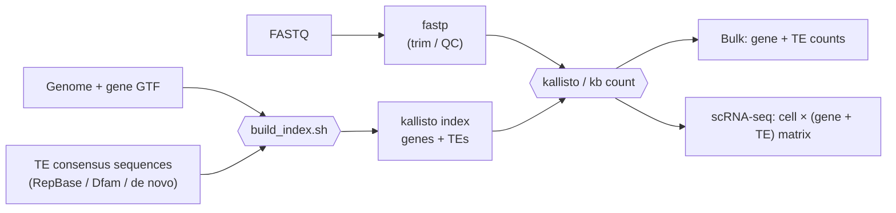

# kallisto-TE

**Quantify transposable element (TE) expression together with canonical
genes from bulk and single-cell RNA-seq, using kallisto | bustools.**

Typical workflows ignore the TEs in downstream analysis either leaving them uncounted or unmapped.

kallisto-TE adds the consensus sequence of every TE subfamily (e.g.
`MMERVK10C`, `IAPEz-int`, `L1HS`, `AluY`) to the transcriptome as if it were an
extra gene. A single pseudoalignment then gives you one count matrix with
**genes and TE subfamilies side by side**, using the same index for bulk
RNA-seq (`kallisto quant` / `kb count`) and droplet single-cell RNA-seq
(`kb count`, 10x Genomics and others).

It works for **mouse and human out of the box** and for **any other species**
(plants, fish, insects, ...) that has a genome, a gene annotation and TE
consensus sequences.



---

## Quick start

```bash
# 1. Get the code and the software
git clone https://github.com/issabrianzhang/kallisto-TE.git
cd kallisto-TE
mamba env create -f envs/kallisto_te.yaml      # or: conda env create -f envs/kallisto_te.yaml
conda activate kallisto_te

# 2. Make sure it works (toy data, < 1 minute)
bash test/run_toy_test.sh

# 3. Build a real index (RepBase archive downloaded from girinst.org)
bash scripts/index/build_index.sh \
    --species mouse \
    --repbase /path/to/RepBase25.05.fasta.tar.gz \
    --name mm10_GencodeM25_RepBase25.05 \
    --outdir /path/to/references/mm10_TE \
    --threads 16
```

Output used for quantification: `index/<name>_genes_TE.idx` and
`index/t2g.txt`. TEs are the `t2g.txt` rows whose gene name starts with
`TE:`.

---

## Tutorial

| Step | Guide | Status |
|------|-------|--------|
| 0 | Install (`envs/kallisto_te.yaml`) and run the toy test | ✅ |
| 1 | [Build a genes + TE index: mouse and human](docs/01_build_index.md) | ✅ |
| 1b | [Build an index for your own species (worked example: *Arabidopsis*)](docs/02_custom_species.md) | ✅ |
| 2 | Read trimming and QC with fastp | 🚧 coming soon |
| 3 | Bulk RNA-seq quantification | 🚧 coming soon |
| 4 | Single-cell RNA-seq quantification (`kb count`) | 🚧 coming soon |
| 5 | Snakemake pipeline (steps 1–4 in one command) | 🚧 coming soon |

### Ready-made presets

| `--species` | Genome | Gene annotation | TE library (RepBase files) |
|-------------|--------|-----------------|----------------------------|
| `mouse` | GRCm38 / mm10 primary assembly | GENCODE M25 | `mousub.ref` + `rodrep.ref` (we used RepBase 25.05) |
| `human` | GRCh38 / hg38 primary assembly | GENCODE v40 basic | `humrep.ref` + `humsub.ref` (we used RepBase 28.04) |
| `custom` | any FASTA | any GTF | any TE consensus FASTA, or RepBase files of your choice |

---

## Repository layout

```
kallisto-TE/
├── README.md
├── envs/
│   └── kallisto_te.yaml               # conda environment (kb-python, samtools)
├── docs/
│   ├── 01_build_index.md              # step-by-step: mouse & human index
│   └── 02_custom_species.md           # step-by-step: any species (Arabidopsis example)
├── scripts/
│   ├── index/
│   │   ├── build_index.sh             # one command: TE library -> pseudo-GTF -> kb ref -> check
│   │   ├── prepare_te_library.sh      # merge, clean names, de-duplicate TE consensus FASTA
│   │   ├── make_te_pseudo_gtf.sh      # one "gene" per TE consensus
│   │   ├── extract_repbase_species.sh # pull a species' TEs out of RepBase by name
│   │   └── check_index.sh             # verify every TE made it into the index
│   └── optional/
│       └── repeatmasker_genome.sbatch # locus-level TE annotation with the same library
├── slurm/                             # example SLURM jobs (edit paths and partition)
│   ├── build_index_mouse_mm10.sbatch
│   ├── build_index_human_hg38.sbatch
│   └── build_index_custom_species.sbatch
└── test/
    └── run_toy_test.sh                # tiny end-to-end test
```

Each script prints its own help with `-h`, e.g.
`bash scripts/index/build_index.sh -h`.

---

## Requirements

* Linux (HPC) or macOS, `bash`
* [conda](https://docs.conda.io/) / [mamba](https://mamba.readthedocs.io/)
* [`kb-python`](https://github.com/pachterlab/kb_python) 0.30.2 (installed by
  the environment file; bundles kallisto and bustools)
* A TE consensus library: [RepBase](https://www.girinst.org/repbase/) (free
  academic registration; files cannot be redistributed), or
  [Dfam](https://www.dfam.org/), or a de novo library
  (EDTA / RepeatModeler2)
* For mammals: ~64 GB RAM and ~100 GB disk while building the index

Already have kb-python? These also work:

```bash
pip install kb-python
# or
conda create -n kallisto_te -c conda-forge -c bioconda kb-python
```

Use the same kb-python version to build the index and to quantify.

---

## Citation

If you use this workflow, please cite the consensus-level pseudoalignment
approach and the tools it relies on:

* de Villarreal JM, *et al.* Pseudoalignment tools as an efficient
  alternative to detect repeated transposable elements in scRNAseq data.
  *Bioinformatics* 39(1) (2023).
  [doi:10.1093/bioinformatics/btac737](https://doi.org/10.1093/bioinformatics/btac737)
* Bray NL, *et al.* Near-optimal probabilistic RNA-seq quantification.
  *Nat Biotechnol* 34, 525–527 (2016). (kallisto)
* Melsted P, *et al.* Modular, efficient and constant-memory single-cell
  RNA-seq preprocessing. *Nat Biotechnol* 39, 813–818 (2021). (kallisto | bustools)
* Bao W, Kojima KK, Kohany O. Repbase Update, a database of repetitive
  elements in eukaryotic genomes. *Mob DNA* 6, 11 (2015). (if you use RepBase)

## License

[MIT](LICENSE) © 2026 Brian Zhang
