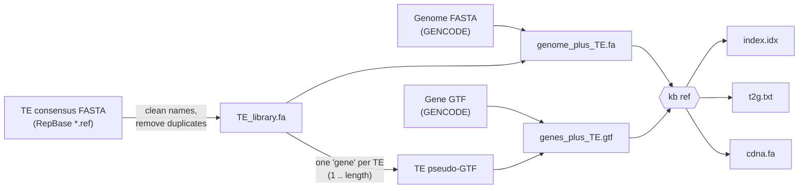

# Step 1 — Build a genes + TE kallisto index (mouse and human)

This page walks through building the reference that everything else in
kallisto-TE uses: **one kallisto index that contains every annotated
transcript _and_ every transposable element (TE) consensus sequence.**
Reads are then pseudoaligned once and counted for genes and TE subfamilies
at the same time, for both bulk and single-cell RNA-seq.

> Working on another organism (plants, fish, flies, ...)? Read this page for
> the concepts, then follow [02_custom_species.md](02_custom_species.md).

---

## Contents

1. [How it works](#1-how-it-works)
2. [What you need](#2-what-you-need)
3. [Get the TE consensus library (RepBase)](#3-get-the-te-consensus-library-repbase)
4. [Build the index with one command](#4-build-the-index-with-one-command)
5. [What happens at each step](#5-what-happens-at-each-step)
6. [Check the index](#6-check-the-index)
7. [Output files](#7-output-files)
8. [Options and choices](#8-options-and-choices)
9. [Troubleshooting](#9-troubleshooting)

---

## 1. How it works

kallisto needs a set of "target" sequences to pseudoalign reads to. Normally
these are the transcripts of the genome annotation. Here we add one extra
target per TE subfamily: its **consensus sequence**, a single representative
sequence for all genomic copies of that TE (e.g. `MMERVK10C`, `IAPEz-int`,
`L1MdA_I`).

The trick is to make the TE consensus sequences look like ordinary genes to
`kb ref`:



1. Each TE consensus sequence is appended to the genome FASTA as if it were
   a small extra chromosome.
2. A matching **pseudo-GTF** line declares one gene that spans the whole TE:

   ```
   MMERVK10C_ERVK_Mus_musculus  RepBase  gene  1  7323  .  +  .  gene_id "MMERVK10C_ERVK_Mus_musculus"; gene_type "TE"; gene_name "TE:MMERVK10C_ERVK_Mus_musculus";
   ```

3. `kb ref` extracts every transcript (genes **and** TEs) into `cdna.fa`,
   builds the kallisto index and writes `t2g.txt` (transcript → gene table).
   Each TE appears as its own transcript and gene. Its `gene_name` starts
   with `TE:`, so TEs are easy to separate from genes later.

This is the consensus-level pseudoalignment approach described by
de Villarreal *et al.* (2023) *Bioinformatics*,
[doi:10.1093/bioinformatics/btac737](https://doi.org/10.1093/bioinformatics/btac737).

---

## 2. What you need

| Item | Notes |
|------|-------|
| Linux or macOS, `bash`, ~100 GB free disk | Genome + combined FASTA + index for a mammal |
| 32–64 GB RAM, 8–16 CPUs | For `kb ref` on mouse/human. Small genomes need much less |
| conda / mamba | To install `kb-python` |
| RepBase account | TE consensus sequences (see §3) |
| Internet access on the build node | Only for the mouse/human presets, which download GENCODE |

Install the environment once:

```bash
git clone https://github.com/issabrianzhang/kallisto-TE.git
cd kallisto-TE
mamba env create -f envs/kallisto_te.yaml     # or: conda env create -f envs/kallisto_te.yaml
conda activate kallisto_te
```

Check that everything works with a toy run that takes under a minute:

```bash
bash test/run_toy_test.sh
# PASS: index built with 2 genes + 4 TEs (duplicate RLTR10C removed)
```

---

## 3. Get the TE consensus library (RepBase)

RepBase is distributed by the Genetic Information Research Institute (GIRI)
and **requires a (free academic) registration**. The files cannot be
redistributed, which is why they are not included in this repository.

1. Register at <https://www.girinst.org/repbase/>.
2. Download the FASTA-format archive, e.g. `RepBase25.05.fasta.tar.gz` (used
   for our mouse index) or `RepBase28.04.fasta.tar.gz` (used for our human
   index).
3. Copy it to your cluster (`scp`, `rsync`, FileZilla, Cyberduck, ...).

The archive contains one `*.ref` file per group of organisms. The presets
use:

| Species | RepBase files | Contents |
|---------|---------------|----------|
| mouse   | `mousub.ref` + `rodrep.ref` | mouse-specific + general rodent repeats |
| human   | `humrep.ref` + `humsub.ref` | human repeats + human subfamilies (Alu, SVA, ...) |

You do not need to extract the archive yourself; `build_index.sh` does it.
To look inside first:

```bash
tar -tzf RepBase25.05.fasta.tar.gz | head
```

> **No RepBase access?** Any TE consensus FASTA works, for example from Dfam
> or a de novo library from RepeatModeler2/EDTA. See
> [02_custom_species.md §3](02_custom_species.md#3-get-te-consensus-sequences).

---

## 4. Build the index with one command

**Inputs.** The script needs a genome FASTA (`--genome`), a matching gene GTF
(`--gtf`) and a TE library (`--repbase` or `--te-fasta`). You do not supply
a transcriptome FASTA: `kb ref` builds it from the genome + GTF. With the
`mouse` and `human` presets, leaving out `--genome`/`--gtf` downloads the
GENCODE files below. Passing them uses your own files instead (see
[Want a different release](#want-a-different-release-or-your-own-files)).

### Mouse — GRCm38/mm10, GENCODE M25, RepBase 25.05

```bash
bash scripts/index/build_index.sh \
    --species mouse \
    --repbase /path/to/RepBase25.05.fasta.tar.gz \
    --name    mm10_GencodeM25_RepBase25.05 \
    --outdir  /path/to/references/mm10_GencodeM25_RepBase25.05_TE \
    --threads 16
```

### Human — GRCh38/hg38, GENCODE v40, RepBase 28.04

```bash
bash scripts/index/build_index.sh \
    --species human \
    --repbase /path/to/RepBase28.04.fasta.tar.gz \
    --name    hg38_GencodeV40_RepBase28.04 \
    --outdir  /path/to/references/hg38_GencodeV40_RepBase28.04_TE \
    --threads 16
```

The presets download these GENCODE files automatically:

| Preset | Genome | Annotation |
|--------|--------|------------|
| mouse | [`GRCm38.primary_assembly.genome.fa.gz`](https://ftp.ebi.ac.uk/pub/databases/gencode/Gencode_mouse/release_M25/) | `gencode.vM25.primary_assembly.annotation.gtf.gz` |
| human | [`GRCh38.primary_assembly.genome.fa.gz`](https://ftp.ebi.ac.uk/pub/databases/gencode/Gencode_human/release_40/) | `gencode.v40.chr_patch_hapl_scaff.basic.annotation.gtf.gz` |

### Want a different release, or your own files?

Pass `--genome` and `--gtf` directly and nothing is downloaded. This also
works on clusters without internet access on compute nodes:

```bash
bash scripts/index/build_index.sh --species mouse \
    --repbase RepBase28.10.fasta.tar.gz \
    --genome GRCm39.primary_assembly.genome.fa.gz \
    --gtf gencode.vM36.primary_assembly.annotation.gtf.gz \
    --name mm39_GencodeM36_RepBase28.10 --outdir ref/mm39_TE --threads 16
```

### On a SLURM cluster

Ready-to-edit job scripts are in [`slurm/`](../slurm). Change the lines
marked `EDIT` (paths, partition), then:

```bash
mkdir -p logs
sbatch slurm/build_index_mouse_mm10.sbatch
sbatch slurm/build_index_human_hg38.sbatch
```

> If `conda activate` fails inside a job, add `source ~/.bashrc` (or
> `eval "$(conda shell.bash hook)"`) before it.

---

## 5. What happens at each step

`build_index.sh` only chains small scripts in [`scripts/index/`](../scripts/index),
each doing one job. You can run them one at a time to see or change what
happens.

### Step 1 — Prepare the TE library (`prepare_te_library.sh`)

```bash
tar -xzf RepBase25.05.fasta.tar.gz
bash scripts/index/prepare_te_library.sh -o mm10_TE_library.fa \
    RepBase25.05.fasta/mousub.ref RepBase25.05.fasta/rodrep.ref
```

* **Concatenates** the selected `*.ref` files.
* **Cleans the names.** RepBase headers are `NAME<TAB>CLASS<TAB>Species`.
  Spaces, tabs and `/` cause problems in kallisto and in R downstream, so
  they are replaced:

  ```
  >MMERVK10C	ERVK	Mus musculus      ->  >MMERVK10C_ERVK_Mus_musculus
  >MER/ODN	DNA transposon	Rodentia  ->  >MER-ODN_DNA_transposon_Rodentia
  ```

  Keeping the class and species in the name means every count table tells
  you what kind of TE you are looking at.
* **Removes duplicate names.** Some RepBase releases contain the same entry
  twice (human RepBase 28.04 lists `SVA_A` twice, with identical sequences).
  kallisto needs unique names. Identical duplicates are dropped. Duplicates
  with *different* sequences are kept and renamed `NAME_dup1`, ... Every
  action is printed to the log.
* **Stops if a record is empty**, so a broken library can never reach the
  index.

> Avoid removing duplicates with `grep -v` on a multi-line pattern.
> `grep -v` treats every sequence line as its own pattern and also deletes
> identical lines from *other* records, which silently truncates related TEs.

### Step 2 — Make the TE pseudo-GTF (`make_te_pseudo_gtf.sh`)

```bash
bash scripts/index/make_te_pseudo_gtf.sh mm10_TE_library.fa mm10_TE_library.pseudo.gtf
head -2 mm10_TE_library.pseudo.gtf
```

This writes one `gene` line per TE, from position 1 to the sequence length.
`kb ref` turns a gene with no transcripts into a single transcript/exon,
so each TE becomes one target in the index.

### Step 3 — Download the genome and gene annotation

For the presets: GENCODE FASTA + GTF (see table above). For your own files:
`--genome` / `--gtf`. Both may be gzipped.

### Step 4 — Append the TEs to the genome and the GTF

```bash
cat GRCm38.primary_assembly.genome.fa    mm10_TE_library.fa         > mm10_genome_plus_TE.fa
cat gencode.vM25.primary_assembly.annotation.gtf mm10_TE_library.pseudo.gtf > mm10_genes_plus_TE.gtf
```

The script also checks that no TE name clashes with a chromosome name.

### Step 5 — `kb ref`

```bash
kb ref --verbose --overwrite -t 16 \
    --tmp /path/to/a/new/tmp_dir \
    --d-list None \
    -i  index/mm10_genes_TE.idx \
    -g  index/t2g.txt \
    -f1 index/cdna.fa \
    mm10_genome_plus_TE.fa \
    mm10_genes_plus_TE.gtf
```

`kb ref` extracts all transcript sequences (`cdna.fa`), writes `t2g.txt` and
builds the kallisto index (k = 31). `--tmp` must point to a folder that
does **not** exist yet.

---

## 6. Check the index

`build_index.sh` finishes by running `check_index.sh`, which fails loudly
if any TE did not make it into the index:

```
t2g.txt: 116018 transcripts, 62741 genes (1143 TE entries)
TE library: 1143 TE consensus sequences
OK: all 1143 TEs are present in t2g.txt
OK: all 1143 TEs are present in cdna.fa
```

(Roughly what to expect for human GENCODE v40 basic + RepBase 28.04; the
numbers depend on your releases.) Run it on any existing index:

```bash
bash scripts/index/check_index.sh te/mm10_TE_library.fa index/t2g.txt index/cdna.fa
```

Look at a few TE rows yourself:

```bash
grep 'TE:' index/t2g.txt | head
grep -c 'TE:' index/t2g.txt          # number of TE subfamilies in the index
```

---

## 7. Output files

```
<outdir>/
├── build_info.txt                     # inputs, versions and check results (keep this!)
├── te/
│   ├── <name>_TE_library.fa           # cleaned, de-duplicated TE consensus sequences
│   ├── <name>_TE_library.pseudo.gtf   # one gene per TE
│   └── repbase_raw/                   # extracted RepBase archive (deletable)
├── reference/                         # downloaded GENCODE genome + GTF (presets only)
├── combined/
│   ├── <name>_genome_plus_TE.fa       # large; deletable after the build
│   └── <name>_genes_plus_TE.gtf
└── index/
    ├── <name>_genes_TE.idx            # ← kallisto index for quantification
    ├── t2g.txt                        # ← transcript-to-gene table (TEs: gene_name "TE:...")
    ├── cdna.fa                        # all target sequences (genes + TEs)
    └── kb_ref.log
```

For quantification you need **`index/*.idx`** and **`index/t2g.txt`**.

---

## 8. Options and choices

| Option | Default | Meaning |
|--------|---------|---------|
| `--species` | — | `mouse`, `human` or `custom` |
| `--repbase` | — | RepBase archive (`.tar.gz`) or the folder it extracts to |
| `--te-libs` | preset | Which `*.ref` files to use, e.g. `"mousub.ref rodrep.ref"` |
| `--te-fasta` | — | Any TE consensus FASTA; can be given several times and combined with `--repbase` |
| `--genome`, `--gtf` | GENCODE (presets) | Your own genome FASTA / GTF (`.gz` OK) |
| `--name` | species | Prefix for output files. Include versions, e.g. `mm10_GencodeM25_RepBase25.05` |
| `--threads` | 8 | Threads for `kb ref` |
| `--d-list` | `none` | `none` or `genome` (see below) |
| `--tmp` | `<outdir>/tmp_kb_<pid>` | Temporary folder for `kb ref`; must not exist yet |

**`--d-list none` vs `genome`.** kb-python ≥ 0.28 (kallisto ≥ 0.50) can
use a "D-list": by default the whole genome. Reads that contain k-mers
found in the genome but not in any target are then discarded instead of
being assigned. That is useful for genes, because it stops intronic or
intergenic reads from being counted as mRNA. TE reads, however, mostly come
from genomic copies that differ a little from the consensus, so a D-list can
discard some genuine TE reads. Our default is `none`. This matches the
published consensus-level approach and indices built with older kb-python
versions, which had no D-list. If you choose `genome`, use the same index for
all samples you compare and note it in your methods.

**Versions matter.** Record the genome build, annotation release, RepBase
release and `kb --version` (all are written to `build_info.txt`). Build and
quantify with the same kb-python version: index formats changed in
kallisto 0.50.

---

## 9. Troubleshooting

| Message | Fix |
|---------|-----|
| `kb not found` | `conda activate kallisto_te` |
| `RepBase library 'xxx.ref' not found` | `tar -tzf RepBase*.tar.gz \| grep '\.ref$'` to see the file names in your release |
| `temporary directory already exists` | Remove it, or pass a new `--tmp` path |
| `TE names also used as genome contig names` | Rename the TE (or the contig) so every name is unique |
| `record has an empty sequence` | The TE FASTA has a header with no sequence; fix the input file |
| `ERROR: N TE(s) are missing from t2g.txt` | Check `index/kb_ref.log`. Usually a TE name with unusual characters; open an issue |
| `kb ref` killed / out of memory | Request more memory (64 GB for mammals) |

Next: preprocessing reads with fastp, then bulk / single-cell quantification
(coming soon, see the [README roadmap](../README.md#roadmap)).
